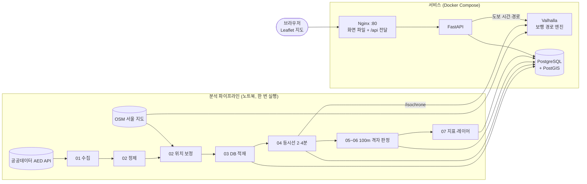
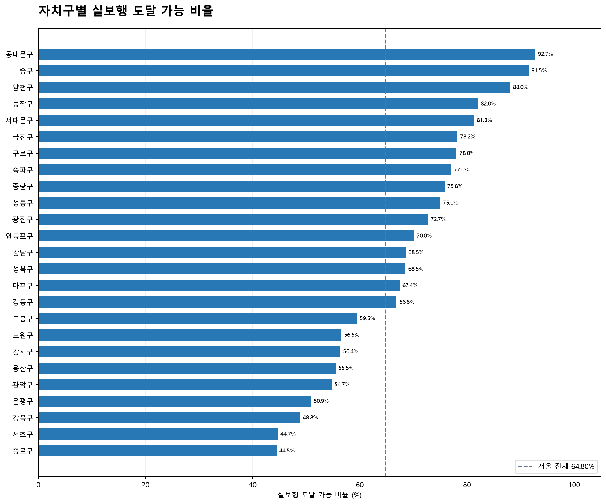
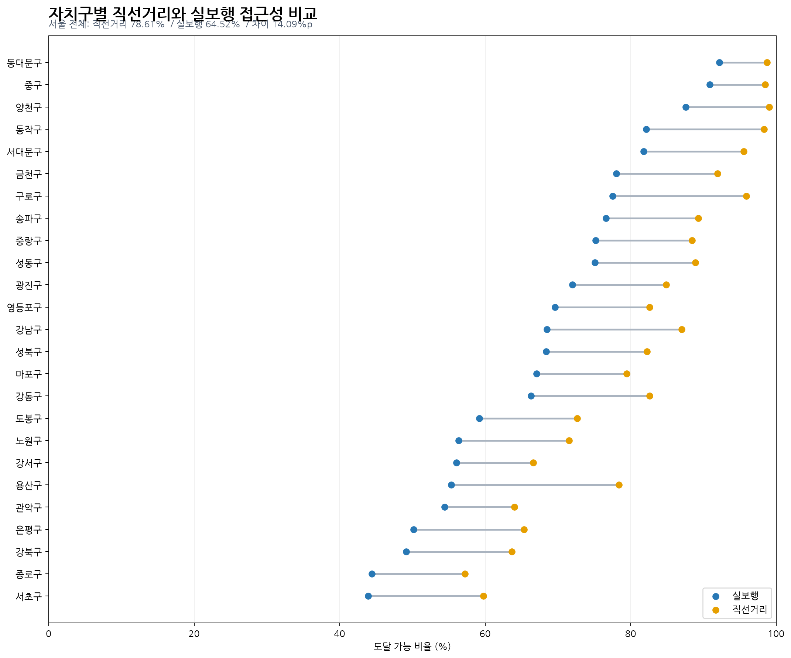
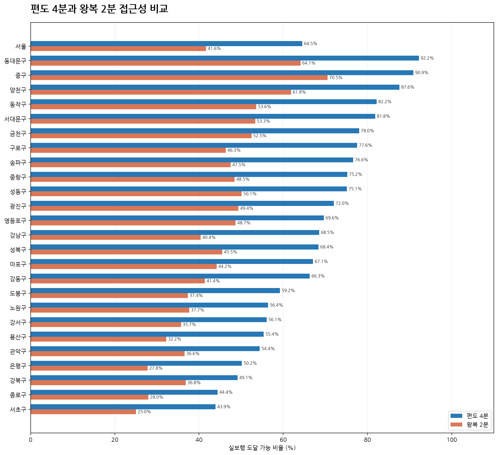

# 실보행 경로 기반 AED 접근성 분석 시스템

서울시 AED까지 **실제로 걸어서** 4분 안에 닿을 수 있는지를 보행 경로와 운영시간으로 분석해,
AED 사각지대와 가장 빨리 닿는 AED까지의 경로를 지도로 보여 주는 웹서비스입니다.


> **이 서비스는 119 신고를 대신하지 않는 분석·참고용 도구입니다.** 심정지 의심 상황에서는 먼저 119에 신고하세요.
> 표시되는 AED 위치·운영 상태·도보 시간은 데이터와 계산 방식의 한계로 실제와 다를 수 있습니다.

## 목차
- [배경](#배경) · [주요 기능](#주요-기능) · [시스템 구조](#시스템-구조) · [분석 방법](#분석-방법) · [분석 결과](#분석-결과)
- [실행 방법](#실행-방법) · [서버 배포](#서버-배포) · [API](#api) · [폴더 구조](#폴더-구조)
- [한계](#한계) · [데이터 출처](#데이터-출처) · [라이선스](#라이선스) · [팀](#팀)

## 배경
AED 접근성을 직선거리로 분석하면 도로 구조, 하천, 큰길, 단지 담장 같은 실제 보행 제약이 빠집니다.
지도에서 가까워 보이는 AED도 실제로 걸으면 한참 돌아가야 할 수 있습니다.
이 프로젝트는 OpenStreetMap 보행 도로망과 Valhalla 경로 엔진으로 서울시 AED까지의 실제 보행 시간을 계산하고,
골든타임(4분) 안에 AED에 닿기 어려운 지역을 직선거리 기준과 비교해 보여 줍니다.

## 주요 기능
- **가장 빨리 닿는 AED 찾기**: 지도를 누른 지점에서 실제 도보 시간이 가장 짧은 AED, 경로, 다음 후보 2개.
  직선거리 1위와 다르면 "직선으로는 가깝지만 실제로는 N분" 안내
- **도달 구역·사각지대 레이어**: AED별 4분(편도)·2분(왕복 기준) 실보행 도달 구역과 그 바깥 사각지대
- **직선거리 vs 실보행 비교**: 반경 340m(170m) 원과 실보행 도달 구역을 겹쳐 차이를 보여 줌
- **실시간 반영**: 지금(서울 시각) 운영 중인 AED만으로 지도·도달 구역·통계·찾기를 다시 계산 (공휴일 반영, 30분 캐시)
- **자치구별 통계**: 25개 구의 실보행 커버리지 순위, 직선 대비 차이(%p), 사각지대 면적
- **AED 위치 보정**: 같은 건물에 겹친 AED를 대수 마커로 묶어 설치 장소(층·동) 목록으로 보여 주고,
  아파트 동별 AED는 해당 동 건물로 옮기며, 위치가 의심스러운 AED에는 안내를 표시
- **오류 제보**: AED를 골라 오류 유형과 설명을 제출 (개인정보 저장 없음)

## 시스템 구조



| 구성 요소 | 기술 | 역할 |
| --- | --- | --- |
| 지도 데이터 | OpenStreetMap | 서울시 보행 도로망 |
| 경로 엔진 | Valhalla 3.9.2 | 등시선(도달 구역), 다대다 도보 시간, 경로 |
| 공간 DB | PostgreSQL 16 + PostGIS 3.4 | AED, 등시선, 격자 판정, 지표, 제보 저장 |
| 분석 | Python 3.12 (GeoPandas, Shapely, SQLAlchemy) | 수집·정제·위치 보정·지표 계산 |
| 백엔드 | FastAPI + Uvicorn | 지도 데이터, 찾기, 통계, 실시간 반영, 제보 API |
| 화면 | HTML/CSS/JavaScript + Leaflet 1.9.4 | 한 페이지 지도 (빌드 도구 없음) |
| 웹 서버 | Nginx 1.31 | 화면 파일 제공, `/api` 전달, gzip, 개인정보 없는 접속 기록 |
| 실행 환경 | Docker Compose | DB·Valhalla·API·Nginx 통합 실행 |

## 분석 방법
`config.yaml`에 분석 조건을 모았습니다. 보행 속도 **5.1km/h**, 격자 **100m**,
편도 **4분**(직선 기준 반경 340m), 왕복 기준 **편도 2분**(170m).

| 단계 | 스크립트 | 하는 일 |
| --- | --- | --- |
| 수집 | `01_collect.py` | 공공데이터 AED API 전체 페이지를 받아 원본 그대로 저장 |
| 정제 | `02_clean.py` | 좌표·주소·중복 검사, 운영시간 해석(`2400`, 자정 넘김, 빈 값) → `results/cleaning_report.csv` |
| 위치 보정 | `02_refine_location.py` | 아파트 "N동" AED를 같은 단지 안 OSM 동 건물로 재배치, 위치 의심 표시 → `results/location_review.csv` |
| 적재 | `03_load_district.py`, `03_load_aed.py` | 자치구 경계 25개, AED를 PostGIS에 적재 |
| 등시선 | `04_isochrone.py`, `04_load_isochrones.py` | AED마다 Valhalla 2·4분 도보 도달 구역 계산·적재 (중단 후 이어서 계산, 좌표가 바뀐 AED만 다시 계산) |
| 격자 판정 | `05_generate_grid.py`, `06_analyze_accessibility.py` | 서울 100m 격자 점마다 직선거리·실보행 도달 여부 판정 |
| 지표 | `07_build_metrics.py`, `plot_metrics.py` | 서울·자치구별 커버리지, 차이(%p), 사각지대 면적, 화면용 합친 다각형, 그래프 |

`python pipeline/run_all.py`가 위 단계를 순서대로 실행하고 하나라도 실패하면 멈춥니다
(`--list`로 단계 확인, `--from`/`--to`로 일부만 실행). 같은 입력이면 몇 번 돌려도 같은 결과가 나옵니다.

## 분석 결과
2026-11-25 수집 AED 11,745대, 2026-11-16 OSM 지도 기준 (`results/metrics.csv`, run 4).

| 기준 | 직선거리 커버리지 | 실보행 커버리지 | 차이 | 실보행 사각지대 |
| --- | ---: | ---: | ---: | ---: |
| 편도 4분 (340m) | 78.64% | **64.80%** | 13.83%p | 213.40km² |
| 왕복 기준 편도 2분 (170m) | 54.65% | **43.04%** | 11.62%p | 345.35km² |

직선거리로 판정하면 서울 격자의 약 79%가 4분 안에 AED에 닿는 것처럼 보이지만,
실제 보행 경로로는 약 65%에 그칩니다. 차이는 자치구마다 크게 달라 동대문구 6.0%p에서 용산구 23.0%p까지 벌어집니다 (편도 기준).

| 자치구별 실보행 커버리지 | 직선 vs 실보행 | 편도 vs 왕복 기준 |
| --- | --- | --- |
|  |  |  |

**검증**
- 자동 판정 정확성: QGIS에서 격자 20개를 직접 확인, 2분·4분 판정 40건 모두 일치 ([docs/manual_validation.md](docs/manual_validation.md))
- 데이터 품질: 원본 11,745건 중 제외 0건, 운영시간 일부 빈값 AED는 "정보 없음"(운영 중으로 간주)으로 처리 ([results/cleaning_report.csv](results/cleaning_report.csv))
- 등시선 계산 실패: 0건
- 위치 보정: 아파트 동 재배치 205건, 위치 의심 146건 (주소·좌표 자치구 불일치 20건, 같은 점에 다른 주소 132건) ([results/location_review.csv](results/location_review.csv))
- `/api/nearest` 응답 시간: 서울 10개 지점 평균 0.27초, 최대 1.73초 (서버 시작 후 첫 요청, 이후 0.07~0.23초)
- 자동 테스트: `pytest` 189개 통과

## 실행 방법

### 요구사항
- Ubuntu 24.04 (WSL2 포함), Docker + Docker Compose, Python 3.12, osmium-tool
- 메모리 8GB 이상 권장 (Valhalla 지도 가공, 등시선 1.1만 개 계산)
- [공공데이터포털](https://www.data.go.kr) "국립중앙의료원_전국 자동심장충격기(AED) 정보 조회 서비스" 인증키 (Decoding 키)

### 1. 저장소와 환경변수
```bash
git clone https://github.com/easyh38/seoul-aed-walk-access.git
cd seoul-aed-walk-access
cp .env.example .env    # POSTGRES_PASSWORD, DATABASE_URL의 비밀번호, AED_API_KEY 입력
```

### 2. 서울 지도 준비
```bash
wget https://download.geofabrik.de/asia/south-korea-latest.osm.pbf
osmium extract -b 126.76,37.41,127.19,37.72 south-korea-latest.osm.pbf \
  -o valhalla/custom_files/seoul.osm.pbf
```
`valhalla/custom_files/`에는 서울 파일 하나만 둡니다. Valhalla는 처음 켤 때 이 파일로 타일을 가공하고(수 분),
이후에는 만들어 둔 타일(`valhalla_tiles.tar`)을 씁니다. 위치 보정 단계도 같은 파일을 읽습니다.

### 3. DB와 Valhalla 켜기
```bash
docker volume create aed-db-data          # 처음 한 번 (개발용 DB 볼륨)
docker compose up -d db valhalla
docker compose logs -f valhalla           # 타일 가공이 끝날 때까지 확인 (Ctrl+C로 나오기)
```
따로 띄워 둔 `aed-db`, `valhalla` 컨테이너가 있으면 먼저 `docker stop aed-db valhalla`로 멈춥니다 (포트·볼륨 충돌).

**이미 쓰던 DB 볼륨이면** 파이프라인 전에 칼럼 추가 SQL을 한 번 실행합니다 (새로 만든 DB는 필요 없음, 여러 번 실행해도 안전).
빠뜨리면 AED 적재 단계와 `/api/aeds`가 `column "location_source" does not exist`로 실패합니다.
```bash
for f in db/migrations/*.sql; do
  docker compose exec -T db sh -c 'psql -U "$POSTGRES_USER" -d "$POSTGRES_DB" -v ON_ERROR_STOP=1' < "$f"
done
```

### 4. 분석 파이프라인 실행 (호스트)
```bash
python3 -m venv .venv && source .venv/bin/activate
pip install -r pipeline/requirements.txt -r api/requirements.txt -r requirements-dev.txt
python pipeline/run_all.py                # 수집부터 지표까지 전체 (등시선 계산이 가장 오래 걸림)
```
이미 받은 원본으로 다시 계산하려면 `--from clean`, 위치 보정부터는 `--from refine`.

### 5. 서비스 전체 실행
```bash
docker compose up -d --build
docker compose ps                         # 모두 running / db는 healthy
```
브라우저에서 **http://localhost:8080** 을 엽니다. API 문서는 http://localhost:8080/docs.

### 테스트
```bash
pytest
```

### 배경지도 (선택)
`web/index.html`의 `<meta name="vworld-key" content="">`에 [VWorld](https://www.vworld.kr) 인증키
(서비스 도메인 등록)를 넣으면 국토교통부 배경지도를 씁니다. 비워 두면 OSM 타일을 씁니다.

## 서버 배포
무거운 계산(지도 가공, 등시선)은 노트북에서 끝내고, 서버에는 **가공된 Valhalla 폴더와 DB 덤프만** 옮깁니다.
서버용 설정(`docker-compose.prod.yml`)은 Nginx 80번만 열고 DB·Valhalla·API 포트는 닫습니다.

```bash
# [노트북] Valhalla 폴더와 DB 덤프 보내기
scp -r valhalla/custom_files 사용자@서버IP:~/seoul-aed-walk-access/valhalla/
docker compose exec -T db sh -c 'pg_dump -U "$POSTGRES_USER" -d "$POSTGRES_DB" -Fc' > aed.dump
scp aed.dump 사용자@서버IP:~/seoul-aed-walk-access/

# [서버] 코드 받기, .env 작성(비밀번호는 노트북과 다르게) 후
export COMPOSE_FILE=docker-compose.yml:docker-compose.prod.yml
docker compose up -d db
docker compose exec -T db sh -c 'pg_restore -U "$POSTGRES_USER" -d "$POSTGRES_DB" --clean --if-exists' < aed.dump
docker compose up -d --build
```
방화벽은 SSH(22)와 HTTP(80)만 엽니다. 브라우저에서 `http://서버IP`로 접속합니다.

## API
FastAPI가 `/docs`에 문서를 자동 생성합니다.

| 메서드 | 경로 | 기능 | 주요 파라미터 |
| --- | --- | --- | --- |
| GET | `/api/aeds` | 화면 범위 안 AED (GeoJSON) | `west`, `south`, `east`, `north`, `open_now` |
| GET | `/api/layers/coverage` | 실보행 도달 구역 다각형 | `mode`(oneway/roundtrip), `open_now` |
| GET | `/api/layers/deadzone` | 사각지대 다각형 | `mode`, `open_now` |
| GET | `/api/stats` | 서울·자치구 지표와 순위 | `mode`, `open_now` |
| GET | `/api/nearest` | 가장 빨리 닿는 AED, 경로, 후보 | `lat`, `lon`, `open_now`, `aed_id` |
| POST | `/api/reports` | 오류 제보 | `aed_id`, `type`, `description` |
| GET | `/api/meta` | 데이터 기준일, 분석 설정 | - |

AED 정보에는 좌표 출처(`location_source`: `api` / `osm_building`)와
위치 의심 표시(`location_flags`: `gu_mismatch`, `mixed_address`)가 들어갑니다.

## 폴더 구조
```
seoul-aed-walk-access/
├── api/                  # FastAPI (routers/: aeds, layers, stats, nearest, reports, meta)
├── pipeline/             # 분석 파이프라인 01~07, run_all.py
├── db/                   # init.sql(스키마), migrations/(기존 DB용 칼럼 추가), seed_dev.sql
├── web/                  # 화면 (index.html, css/, js/, data/, vendor/leaflet)
├── nginx/                # Nginx 설정
├── valhalla/custom_files # 서울 OSM 지도와 가공 타일 (Git 제외)
├── data/                 # raw/(AED 원본, 자치구 경계), clean/(정제 CSV, Git 제외)
├── results/              # 지표 CSV, 그래프, 정제·위치 검토 목록, 수동 검증 자료
├── tests/                # pytest
├── docs/                 # 협업 규칙, 수동 검증 기록
├── config.yaml           # 분석 조건
├── docker-compose.yml    # 개발용 (포트는 127.0.0.1에만)
└── docker-compose.prod.yml  # 서버용 덮어쓰기 (80번만 공개)
```

## 한계
- **AED 위치**: 공공데이터 좌표는 도로명주소를 건물(단지) 대표점으로 바꾼 값이라, 같은 건물의 AED가 한 점에 겹칩니다.
  아파트 동별 AED 일부(205대)만 동 건물로 옮겼고, 층별 AED는 지도에서 나눌 수 없습니다. 공공데이터 자체의 위치 오류도 있을 수 있습니다.
- **OSM 보행로 완성도**: 횡단보도, 육교, 지하보도, 단지 안 통로가 OSM에 없거나 막혀 있으면 실제보다 돌아가는 경로가 나올 수 있습니다.
- **건물 내부 이동 미반영**: 건물 입구까지만 계산합니다. 고층·지하의 AED는 실제로 더 오래 걸립니다.
- **운영시간**: 원본의 운영시간이 비어 있거나 실제와 다를 수 있습니다. 빈 값은 운영 중으로 간주합니다.
- **데이터 시점**: AED와 OSM 데이터는 계속 바뀝니다. 갱신은 파이프라인을 수동으로 다시 실행합니다.
- **119를 대신하지 않습니다.**

## 데이터 출처
- 지도·보행 도로망: © OpenStreetMap contributors (ODbL 1.0), Geofabrik 남한 추출본, 기준 2026-11-16
- AED: 국립중앙의료원 「전국 자동심장충격기(AED) 정보 조회 서비스」 (공공데이터포털), 수집 2026-11-25
- 자치구 경계: 통계청 SGIS 시군구 경계 (2025년 2분기)
- 배경지도(선택): VWorld (국토교통부)

## 라이선스
이 저장소는 [MIT 라이선스](LICENSE)를 따릅니다. 사용한 오픈소스와 데이터의 라이선스는 아래와 같습니다.

| 대상 | 라이선스 | 용도 |
| --- | --- | --- |
| OpenStreetMap 데이터 | ODbL 1.0 | 보행 도로망, 위치 보정, 배경지도(대체) |
| Valhalla | MIT | 보행 경로·등시선 |
| PostgreSQL / PostGIS | PostgreSQL License / GPL-2.0 | 공간 DB (수정 없이 사용) |
| osmium-tool | GPL-3.0 | 서울 지도 자르기 (수정 없이 사용) |
| FastAPI / Uvicorn | MIT / BSD-3 | 백엔드 |
| SQLAlchemy / psycopg2 | MIT / LGPL-3.0 | DB 연결 |
| GeoPandas / Shapely / pyogrio | BSD-3 / BSD-3 / MIT | 공간 데이터 처리 |
| requests / PyYAML / python-dotenv | Apache-2.0 / MIT / BSD-3 | API 호출, 설정 |
| holidays | MIT | 한국 공휴일 판단 |
| matplotlib | PSF 계열 | 지표 그래프 |
| pytest | MIT | 테스트 |
| Leaflet | BSD-2 | 지도 화면 |
| Nginx | BSD-2 | 웹 서버 |
| Pretendard / Inter Tight | SIL OFL 1.1 | 글꼴 (CDN) |
| AED 공공데이터 | 공공데이터포털 이용 조건 | 출처·기준일 표시 |
| VWorld 배경지도 | 공간정보 오픈플랫폼 이용약관 | 배경지도 (선택) |

## 팀
| GitHub | 역할 |
| --- | --- |
| [@daechi0910](https://github.com/daechi0910) | 데이터·분석 (Valhalla 재현, 분석 파이프라인, 운영시간·공휴일 분석) |
| [@leejihwan](https://github.com/leejihwan) | 서비스·배포 (DB, FastAPI, 화면, Docker Compose, 배포) |

설계 문서(요구사항 PRD + 단계별 개발 가이드)는 [guideline.md](guideline.md),
협업 규칙(Issue → 브랜치 → PR → 리뷰 → 병합)은 [docs/WORKFLOW.md](docs/WORKFLOW.md)를 따릅니다.
