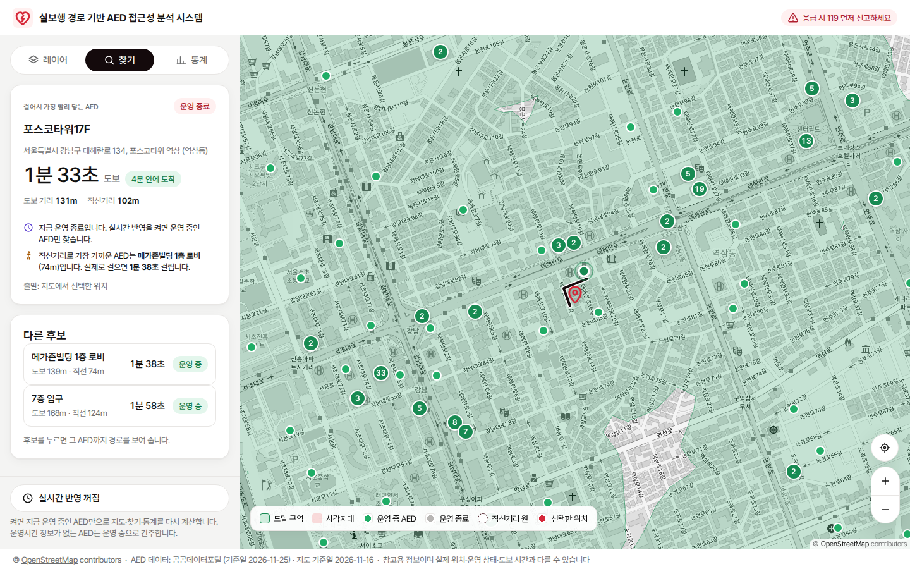

# 실보행 경로 기반 AED 접근성 분석 시스템

서울시 내 AED까지 실제로 걸어서 4분 안에 닿을 수 있는지를 실제 보행 경로와 운영시간으로 분석해,
AED 사각지대와 가장 빨리 닿는 AED까지의 경로를 지도로 보여주는 웹서비스입니다.

<!---->

> 이 서비스는 119 신고를 대신하지 않는 분석·참고용 도구입니다.

## 목차
- [배경](#배경) · [주요 기능](#주요-기능) · [시스템 구조](#시스템-구조) · [설치](#설치)
- [실행](#실행) · [분석 결과](#분석-결과) · [한계](#한계) · [팀](#팀) · [라이선스](#라이선스)

## 배경
AED의 접근성을 판단할 때 직선거리를 기준으로 분석하면 실제 보행자가 이동하는 도로 구조와 경로상의 제약을 충분히 반영하기 어렵다. 특히 지도상으로 가까운 AED라도 실제 보행 경로에 따라 이동 시간에는 차이가 발생할 수 있다. 본 프로젝트는 OpenStreetMap의 보행 도로망과 Valhalla 경로 탐색 엔진을 활용하여 서울시 내 AED까지의 실제 보행 접근 시간을 분석하고, 4분 이내에 도달하기 어려운 접근 취약 지역을 파악하는 것을 목표로 한다.

## 주요 기능
- 현재 위치에서 가장 가까운 AED까지의 실제 보행 경로 및 예상 이동 시간 안내
- AED별 4분 이내 보행 도달 가능 영역 분석 및 사각지대 시각화
- 직선거리 기반 접근성(340m 기준)과 실제 보행 경로 기반 접근성 비교
- AED 운영시간 정보를 고려한 이용 가능 여부 분석
- 서울시 및 자치구별 AED 접근성 통계 제공
- AED 위치 정보 오류 제보 기능

## 시스템 구조

| 구성 요소 | 기술 및 도구 | 역할 |
| --- | --- | --- |
| 지도 데이터 | OpenStreetMap(OSM) | 서울시 보행 도로망 및 공간 데이터 제공 |
| 경로 탐색 | Valhalla | 실제 보행 경로 및 도달 가능 영역(등시선) 계산 |
| 공간 데이터베이스 | PostgreSQL + PostGIS | AED 위치, 행정구역 및 공간 분석 결과 저장 |
| 데이터 수집·분석 | Python | AED 데이터 수집, 정제 및 접근성 지표 계산 |
| 백엔드 API | FastAPI | 분석 결과 조회 및 프론트엔드와 데이터 연동 |
| 웹 서버 | Nginx | 웹 페이지 제공 및 API 요청 전달 |
| 실행 환경 | Docker, Docker Compose | 각 구성 요소의 컨테이너 실행 및 통합 관리 |

### 폴더 구조
seoul-aed-walk-access/
├── .github/              # GitHub 관련 설정
├── api/
│   └── routers/          # API 라우터
├── data/
│   ├── raw/              # 원본 AED 데이터
│   └── clean/            # 정제된 AED 데이터
├── db/                   # 데이터베이스 설정 및 스키마
├── docs/                 # 프로젝트 문서
├── nginx/                # 웹 서버 설정
├── pipeline/             # AED 데이터 분석 파이프라인
├── results/              # 분석 결과 및 시각화
├── tests/                # 테스트 코드
├── valhalla/
│   └── custom_files/     # 지도 데이터
├── web/
│   ├── css/
│   ├── fonts/
│   ├── icons/
│   └── js/
├── .gitignore
├── .gitmessage.txt
├── LICENSE
└── README.md

## 설치
### 요구사항
- Ubuntu 24.04, Docker + Docker Compose, osmium-tool
- 메모리 8GB 이상 권장

### 준비
1. 저장소 받기: `git clone ...`
2. 서울 지도 준비: (1-1의 명령)
3. 환경변수: `cp .env.example .env` 후 API 키 입력

## 실행
```bash
docker compose up -d --build
docker compose run --rm pipeline
```
브라우저에서 http://localhost 접속. 배포 방법은 [docs/deploy.md](docs/deploy.md)

## 분석 결과
분석 조건(config.yaml)과 핵심 수치, 그래프 (results/)

## 한계
OSM 보행로 완성도, 건물 내부 이동 미반영, AED 데이터 오류 가능성

## 팀
| 이름 | 역할 |
| --- | --- |
| ○○○ | 데이터·분석 |
| ○○○ | 서비스·배포 |

## 기여 방법
브랜치·커밋·PR 규칙 (CONTRIBUTING.md 또는 docs/commit-convention.md 참고)

## 데이터 출처
- © OpenStreetMap contributors (ODbL 1.0), 기준일 YYYY-MM-DD
- 국립중앙의료원 전국 AED 정보 조회 서비스 (공공데이터포털), 수집일 YYYY-MM-DD

## 라이선스
이 저장소는 MIT 라이선스를 따릅니다. 사용한 오픈소스의 라이선스는 아래와 같습니다.
(PRD 8-4 라이선스 표)
